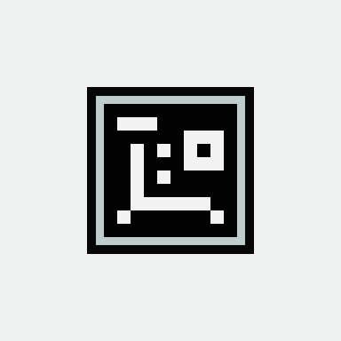
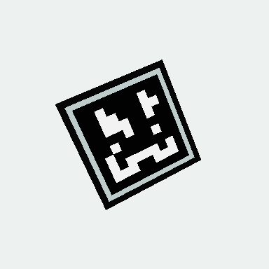
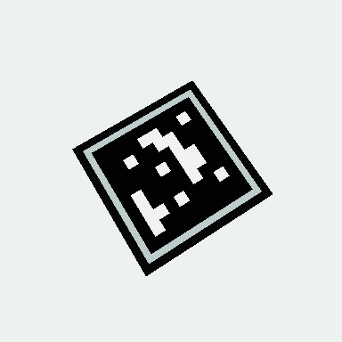

# Cubos de trayectoria · evidencia del 23 de noviembre de 2026

Esta carpeta conserva las comprobaciones del glifo de **10 × 10 celdas** y del seguimiento terrestre mediante motores y servos reales del juego. Son dos verificaciones distintas: render de píxeles mediante EGL/GLES y lógica/física mediante Node/Cannon. Ninguna constituye una partida de navegador ni una medición de FPS.

## Render del glifo

El instrumento [`validate-trajectory-gles.py`](../../../tests/validate-trajectory-gles.py) ejecuta el renderer de producción con el harness como registrador de WebGL. Captura los shaders, la subida del atlas, los buffers y las llamadas de dibujo reales. EGL compila esos shaders y reproduce los comandos en Mesa llvmpipe. La prueba compara el centro proyectado de cada celda con el catálogo y comprueba por separado cuatro muestras de la carcasa.

| Comprobación | Resultado por ruta |
| --- | ---: |
| Glifos del catálogo | 144 |
| Celdas por glifo | 100 |
| Escenas | 148 |
| Celdas verificadas | 14.800 |
| Muestras de carcasa verificadas | 592 |
| Shaders compilados / programas enlazados | 2 / 1 |
| Subidas del atlas | 1 |
| Tamaño del atlas RGBA8 | 256 × 256; 262.144 bytes |
| Errores GL | 0 |

Las 148 escenas incluyen los 144 glifos, un cubo inclinado, la cara orientada hacia arriba, una carcasa blanca y un cubo sin pareja. El atlas se compara byte a byte con el catálogo: casillas de 16 × 16 texeles, margen de tres texeles y la cuadrícula íntegra de 10 × 10. El perímetro negro pertenece a esas cien celdas. La carcasa clara se dibuja por separado y no ocupa ninguna de ellas. Se verifican los filtros `NEAREST` y el ajuste de bordes `CLAMP_TO_EDGE`.

La ruta WebGL 1 se reproduce con **OpenGL ES 2.0**, y la ruta WebGL 2 con **OpenGL ES 3.0**, incluida su configuración de atributos mediante VAO. Se limita la versión anunciada por Mesa porque un contexto solicitado como ES 2 puede devolver una versión superior. El renderer registrado es `llvmpipe (LLVM 19.1.7, 256 bits)`, Mesa `25.0.7-2+deb13u1`.

**Las 148 parejas de imágenes coinciden píxel a píxel entre ambas rutas.** En total se verifican 29.600 celdas. No se detectaron inversión, deformación ni invasión del marco en estas escenas. El informe conserva los hashes RGBA de todos los fotogramas, aunque aquí sólo se incluyen tres PNG representativos de WebGL 1 para evitar duplicados.

### Muestras inspeccionadas

Glifo original, índice 0:



Variante inclinada, índice 79:



Cara hacia arriba, índice 132:



Los tres archivos se inspeccionaron visualmente además de las comprobaciones de píxeles. Son imágenes generadas por el shader real; no son ilustraciones generativas ni capturas de navegador.

### Fuente verificada

SHA-256 de `assets/js/game.js` usado para las dos capturas:

```text
898cdff35839c7f7f3c4d756b3ec7bf548832d8b6e71691957a2bf0b87d643a1
```

SHA-256 de `assets/js/trajectory-model.js`:

```text
aae956f7218e1dbd5af7e397f5061e0ad621da3df9e5eb34ffa0e6b57a05e548
```

Los hashes identifican la fuente ensayada; si cambia, estas capturas siguen documentando esa versión y deben regenerarse para acreditar la nueva. `sourceStillCurrent` en la comparación describe la comprobación realizada al guardar la evidencia, no una garantía sobre revisiones posteriores.

## Seguimiento físico terrestre

Se ejecutaron nuevamente **21 pruebas: 7 de dirección y 14 de controlador**, todas aprobadas, sin fallos, cancelaciones ni omisiones. Las pruebas físicas usan el Cannon y las funciones reales de motores y marcha del juego a **120 pasos de física por segundo simulado**. La orientación se actualiza como máximo a **20 decisiones por segundo simulado**.

| Ensayo físico | Ventana simulada | Condiciones aprobadas |
| --- | --- | --- |
| Vehículo de cuatro motores; destino desplazado +0,45 m en X y −0,12 m en Z | 10 s | Se acerca a menos de 0,07 m; termina a menos de 0,10 m; gira por tracción diferencial; conserva torque máximo 0,8 y configuración; consume energía. |
| Cuadrúpedo de ocho servos; destino desplazado +0,90 m en X y −0,30 m en Z | 20 s | Se acerca a menos de 0,085 m; termina a menos de 0,10 m; error articular menor de 10°; torque máximo 3,2; componente Y de su eje vertical mayor de 0,98. |
| Controlador de ruedas: inicio, espera de 0,2 s y descarga | Hasta 30 s | Completa ambos tramos, espera, invoca la descarga una vez y apaga los motores; distancia final menor de 0,10 m. |
| Controlador de ruedas: recorrido de tres puntos e ida y vuelta | Hasta 30 s | Orden observado `0 → 1 → 2 → 1 → 0 → 1`; vuelve a menos de 0,10 m del inicio; ningún paso físico desplaza el cuerpo 0,05 m o más. |
| Controlador de marcha: inicio y destino +0,90 m en X y −0,30 m en Z | Hasta 25 s | Inicia la marcha existente, completa el recorrido a menos de 0,11 m y detiene los ocho servos y el controlador de marcha. |

Las distancias y ventanas de la tabla son **umbrales de las aserciones aprobadas**, no valores medios de precisión ni promesas para cualquier construcción. Los casos usan los mecanismos concretos definidos en [`trajectory-fixtures.cjs`](../../../tests/trajectory-fixtures.cjs). La guía terrestre genera órdenes para los actuadores existentes: mantiene RPM, dirección configurada, torque, capacidad y comprobaciones de energía; los cuerpos siguen siendo dinámicos.

El controlador también comprueba exclusividad del receptor, deshacer un inicio parcial fallido, rechazo de un mecanismo que ya estaba funcionando manualmente, parada ante obstáculos, falta de energía, agarre, modificación de la ruta o de su mecanismo, y agotamiento del presupuesto de progreso. Un cambio de topología ajeno vuelve a comprobar el mecanismo propio una vez y permite continuar si no cambió. La pausa no consume el tiempo de espera. Las solicitudes de guía no vuelven a encender un motor detenido por energía agotada.

**Límite de la prueba de descarga:** el ensayo del controlador usa una función adaptadora simulada que cuenta invocaciones. Comprueba llegada, espera y una única orden de descarga; no acredita que una pinza haya soltado físicamente una carga. Las pruebas lógicas de estados emplean además adaptadores y posiciones simuladas, mientras los cinco casos de la tabla sí ejecutan locomoción con Cannon.

Los resultados de estas pruebas no son un benchmark de CPU, una medición de GPU, una tasa de fotogramas ni una garantía de comportamiento para toda geometría, terreno o carga. La validación de drones pertenece a su suite de vuelo y no está incluida en las 21 pruebas aquí documentadas.

## Reproducción

Desde la raíz del repositorio, con Node, Python 3 y `libEGL.so.1` de Mesa disponibles:

```bash
node --test tests/trajectory-drive.test.cjs tests/trajectory-controller.test.cjs
python3 tests/validate-trajectory-gles.py /tmp/qbits-trajectory/webgl1
QBITS_RENDER_BACKEND=webgl2 python3 tests/validate-trajectory-gles.py /tmp/qbits-trajectory/webgl2
```

El validador usa sólo la biblioteca estándar de Python. Regenera nueve PNG de muestra por ruta, los resúmenes de los 148 fotogramas y el registro comprimido de comandos. Esta carpeta conserva únicamente tres PNG, los resúmenes y la comparación; los demás nombres de PNG de los resúmenes corresponden a esos resultados regenerables.

Para comparar las dos ejecuciones:

```bash
python3 - <<'PY'
import json
from pathlib import Path
root = Path('/tmp/qbits-trajectory')
a = json.loads((root / 'webgl1/summary.json').read_text())
b = json.loads((root / 'webgl2/summary.json').read_text())
assert a['sourceSha256'] == b['sourceSha256']
assert a['modelSha256'] == b['modelSha256']
assert len(a['snapshots']) == len(b['snapshots']) == 148
assert all(x['name'] == y['name'] and x['rgbaSha256'] == y['rgbaSha256']
           for x, y in zip(a['snapshots'], b['snapshots']))
print('148 parejas idénticas; 29.600 celdas comprobadas')
PY
```

## Archivos de resultados

- [`render-summary-webgl1.json`](render-summary-webgl1.json): configuración GLES 2, hashes y resultados por fotograma.
- [`render-summary-webgl2.json`](render-summary-webgl2.json): configuración GLES 3, hashes y resultados por fotograma.
- [`render-comparison.json`](render-comparison.json): comparación de los dos conjuntos, con el número de PNG generados en la ejecución completa.
- [`physics-summary.json`](physics-summary.json): resultado de las 21 pruebas, fuentes con SHA-256, configuración de simulación y aserciones físicas aprobadas.

Quedan fuera del alcance la interacción real de mouse/teclado, foco y diseño de los paneles en navegador, otros drivers gráficos, precisión visual a distancias extremas, rendimiento y garantías para mecanismos distintos de los fixtures ensayados.
