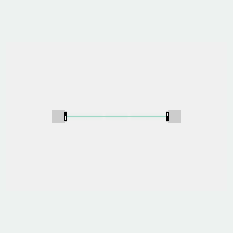
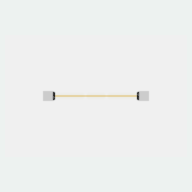
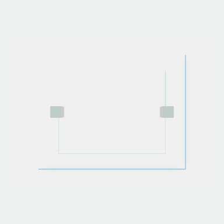

# Mecanismos en vuelo y líneas QR — 24 de noviembre de 2026

Base: `99e4425c6427b2573bc134c61ff9ca10ae28551d`. Recursos: `20261124-flight-mechanisms-1`.

## Qué se comprobó

El brazo y la cinta compartían un anclaje automático que convertía la base a cinemática y apagaba el vuelo. Se permite trabajar desde un chasis aéreo dinámico, se conserva el bloqueo de anclajes fijos explícitos y el despegue fallido no libera los soportes existentes. Restaurar el vuelo antes de los programas evita reproducir el defecto al cargar.

La actitud usaba una respuesta fija demasiado débil para un cubo de 1 u sostenido por el brazo. La nueva respuesta depende del empuje y la inercia, con el mismo techo de torque: `norma(fuerza) × 0,1 / número de portadores`. El transporte de una cinta usa la velocidad de su propia base en el punto de contacto y aplica una reacción igual y opuesta al portador libre.

Las rutas QR extienden su cinta visual de piso bajo ambos cubos. Los puntos de viaje, acciones, alcance y datos guardados se conservan. Las pruebas inspeccionan la geometría subida, reutilización y liberación de buffers; la prueba gráfica comprueba píxeles visibles y oclusión por los cubos.

## Lógica y física

`node --test tests/*.test.cjs`: **1.652 aprobadas**, cero fallos, cancelaciones, omisiones o pendientes. Salida completa comprimida: [tests-final.log.gz](tests-final.log.gz).

Las 22 pruebas nuevas se distribuyen en:

| Archivo | Casos nuevos | Evidencia |
| --- | ---: | --- |
| `tests/flight-mechanisms.test.cjs` | 16 | Brazo original de cuatro articulaciones y cuatro hélices; A/B y otros ejes; arranque en ambos órdenes; parada y sensor independientes; límites, caída, aterrizaje, recuperación JSON y ciclo con carga real. |
| `tests/conveyor-flight-traction.test.cjs` | 2 | Un cubo de 1 u cruza la cinta mientras el dron avanza; fuerza y gasto invariantes ante movimiento común, con reacción física sobre el chasis. |
| `tests/trajectory-game.test.cjs` | 4 | Extremos bajo balizas rotadas, proyección aérea, vista previa, movimiento de balizas y vida de buffers. |

La receta del brazo conserva sus cuatro articulaciones reales. El caso compacto usa un bastidor de 0,90 × 0,72 m entre hélices, una postura B enseñada mediante giro físico de 30° y transporte a 1 rpm. Recoge un cubo de 1 u, lo sostiene durante más de dos segundos, lo lleva a B y lo suelta sin interrumpir el vuelo. Una postura de 90° que atraviesa ese bastidor sigue siendo rechazada por el planificador.

Comparación sin reemplazar el checkout: la fuente original se entrega al harness mediante `options.gameSource`. Quince de las dieciséis regresiones de vuelo fallan contra la base; la protección de rotor fijo pasa en ambas. Las cuatro de QR fallan contra la base. Al conservar los otros cambios y revertir solo la tracción, fallan sus dos regresiones. Al revertir solo la actitud, el ciclo compacto con carga vuelve a fallar por inclinación de las hélices.

Estas pruebas ejecutan juego y Cannon reales; DOM, audio y llamadas de GPU están instrumentados. No son partidas de navegador.

## Dibujo con GLES

Se ejecutó `tests/validate-trajectory-gles.py` mediante los caminos de WebGL 1 y WebGL 2. Mesa llvmpipe reprodujo los shaders, buffers y órdenes capturados del renderer de producción.

- 151 escenas por backend, con resultados de píxeles idénticos entre ambos.
- 14.800 celdas de identidad comprobadas por backend y cuatro muestras de carcasa en cada una de las 148 escenas de caras.
- Tres escenas adicionales por backend: línea de suelo, borrador de trazado y proyección de vuelo.
- 36 muestras de continuidad y seis muestras de oclusión por backend.
- Cero errores de GLES; un atlas compartido por ejecución.

La fixture de 384 × 384 usa el grosor configurable 4× para evitar que el núcleo de una línea subpíxel confunda una prueba de continuidad con una de aliasing. No altera el grosor predeterminado del juego.







Resúmenes con hashes de fuente y píxeles: [WebGL 1](webgl1.json) y [WebGL 2](webgl2.json). La comprobación general de foco y posprocesado también pasó en EGL/GLES; no se modificaron shaders.

## Reproducir

```sh
node --test tests/*.test.cjs
python3 tests/validate-trajectory-gles.py /tmp/qbits-vuelo-qr/webgl1
QBITS_RENDER_BACKEND=webgl2 python3 tests/validate-trajectory-gles.py /tmp/qbits-vuelo-qr/webgl2
python3 tests/validate-focus-gles.py
node --check assets/js/game.js
node --check assets/js/boot.js
git diff --check
```

## Límites

No se certificaron controles visuales, comodidad o FPS de una partida en navegador. La prueba en la construcción concreta del jugador sigue pendiente. Este arreglo no amplía el reconocimiento de seguidores QR a componentes con un brazo o una cinta registrados; esa restricción previa de navegación permanece.
