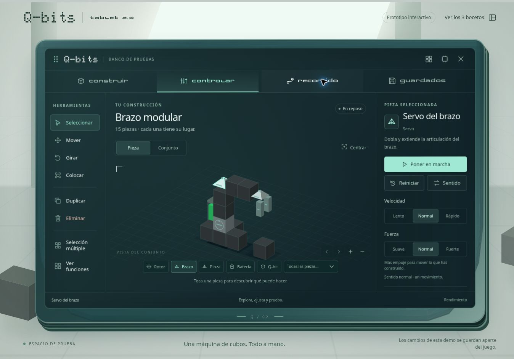
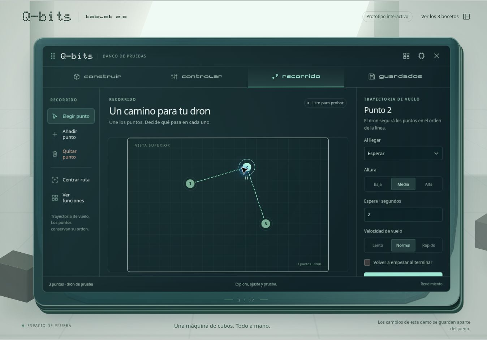
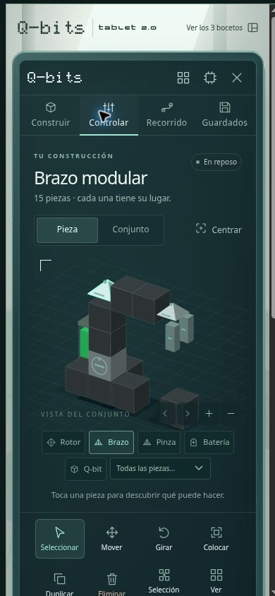
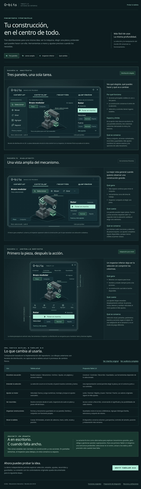
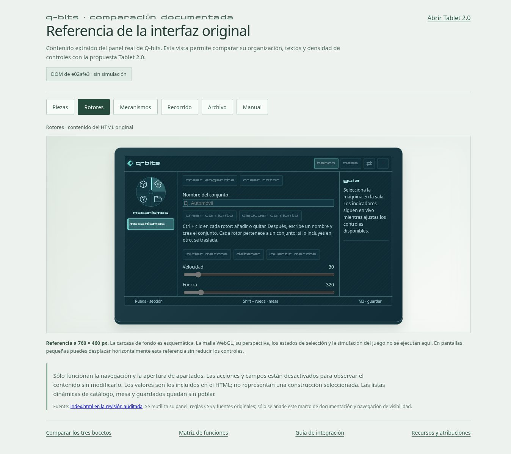

# Q-bits — Tablet 2.0

**Prototipo independiente de la nueva tableta: una construcción visible en el centro, herramientas a la izquierda y controles que responden a la selección.** Las cuatro secciones —Construir, Controlar, Recorrido y Guardados— permiten probar la propuesta sin ejecutar el juego ni una segunda simulación física.

El trabajo parte de la implementación real de [Q-bits en `e02afe3`](https://github.com/dbastias37/Q-bits/tree/e02afe3d1bd9a0d116c5c915e5efc960caa5a26a). La carpeta `tablet-v2/` no se carga desde el juego principal. La selección del mundo, los controles de teclado y ratón, los encajes, Cannon.js, los controladores de mecanismos y las partidas originales conservan su implementación.

**Rama:** `feat/tablet-v2-interactive-prototype`. Este trabajo prepara la revisión y una integración posterior; no autoriza ni realiza un merge a `main`.

**Demo alojada para revisión:** <https://qbits-tablet-v2.diegobastiascl.chatgpt.site> (acceso privado del propietario).

**Evidencia:** [validación, resoluciones y rendimiento](docs/VALIDACION.md).

## Abrir y revisar

La demo es un sitio estático. No necesita instalar paquetes, compilar ni levantar un servidor de física. Desde la raíz del repositorio:

```sh
python3 -m http.server 8000 --bind 127.0.0.1
```

Abre estas páginas en un navegador moderno con JavaScript habilitado:

| Página | URL local | Qué permite revisar |
| --- | --- | --- |
| Prototipo | <http://127.0.0.1:8000/tablet-v2/> | Las cuatro secciones, selección, controles, recorridos, guardados y presentación de la tableta. |
| Tres bocetos | <http://127.0.0.1:8000/tablet-v2/design.html> | Comparación de distribuciones y decisión de diseño. |
| Referencia original | <http://127.0.0.1:8000/tablet-v2/docs/original-reference.html?page=mechanisms&focus=create-rotor> | El DOM y los estilos originales de la tableta, en lectura, sin ejecutar el juego. |

Sirve la raíz completa: la demo reutiliza fuentes y módulos de datos de `../assets/`. Abrir `index.html` con `file://` no es la forma de ejecución prevista para los módulos JavaScript.

## Qué puedes probar

### Construir

Selecciona una pieza con un clic en la vista central o por su nombre. **Pieza / Conjunto** cambia el alcance de la selección; la selección múltiple permite reunir piezas concretas. El contorno, el nombre, el tipo y las acciones disponibles se actualizan a partir del mismo estado del prototipo.

La vista permite orbitar, acercar, alejar y centrar la construcción. Mover y girar modifican la representación de prueba. **Colocar** muestra una guía cuya posición se confirma o se cancela; cancelar conserva la pose anterior. Estas interacciones pertenecen a esta página aislada y no redefinen la manipulación del mundo 3D.

**Agrupar** representa la familia inventario que ya existe en Q-bits: conserva las piezas, sus identidades, sus ajustes y la carga de sus baterías. Recuperar la familia devuelve su contenido y respeta un desplazamiento realizado mientras estaba agrupada. No se presenta esta acción como una nueva soldadura física. El límite original de 100 piezas por familia se conserva en el modelo de prueba.

Duplicar crea identidades nuevas y reproduce la regla de las baterías copiadas vacías. Eliminar, duplicar y transformar muestran su disponibilidad según el tipo de selección y el estado de marcha. El prototipo diferencia las piezas del brazo de prueba, el cubo independiente, las familias y el dron del recorrido.

### Controlar

Un rotor y los servos del mecanismo pueden ponerse en marcha, detenerse, reiniciarse e invertir su sentido dentro de la vista demostrativa. La marcha es una animación cinemática explícita: permite evaluar la respuesta de la interfaz sin fingir consumo energético, esfuerzo real, colisiones o rendimiento de una construcción física.

Los ajustes incompatibles quedan bloqueados durante la prueba. Detener deja el mecanismo en reposo; reiniciar no sustituye los valores personalizados ni rellena una batería. El interruptor de la batería cambia su estado sin simular consumo.

Los primeros controles usan palabras. **Más ajustes** conserva la edición numérica, sus unidades, límites y opciones específicas. Un valor que no corresponde a un preset se muestra como **Personalizado**. Elegir una pieza o abrir un panel no aplica valores por defecto.

| Tipo | Lento | Normal | Rápido | Unidad original |
| --- | ---: | ---: | ---: | --- |
| Rotor | 15 | 30 | 90 | rpm |
| Servo | 15 | 45 | 135 | °/s |
| Dron / prueba de recorrido | 0,25 | 0,5 | 1 | m/s |

Los presets **Suave / Normal / Fuerte** de los motores equivalen a 80 / 320 / 800 en el control original de fuerza, es decir, a 0,8 / 3,2 / 8 N·m de torque máximo. Fuerza y torque son dos presentaciones del mismo parámetro; la capacidad de carga permanece independiente. El dron no recibe un control de fuerza inventado.

Estos presets son decisiones de interfaz sobre valores permitidos, no garantías de carga o movimiento. La [auditoría](docs/AUDITORIA.md) documenta los límites del banco, los valores por defecto y los límites de campaña que una futura integración tendrá que consultar en vivo.

### Recorrido

El editor trabaja con la estructura real del vuelo:

```js
{
  loop: false,
  points: [
    { x: -1.6, z: -0.8, height: 0.65, action: 'pass', wait: 0 }
  ]
}
```

Selecciona un punto, añádelo sobre el mapa, arrástralo, edita sus coordenadas o elimínalo. Los marcadores conservan su identidad y su orden; no se añade una operación de reordenación inexistente en la interfaz original. Los puntos enfocados también admiten desplazamientos con las flechas del teclado.

Se mantienen los límites originales: **48 puntos**, X/Z entre **−28 y 28 m**, altura entre **0,15 y 3 m**, espera entre **0 y 120 s**, acciones `pass`, `wait` y `land`, y repetición de la ruta. La velocidad de vuelo conserva el intervalo 0–1,2 m/s. En la prueba de ruta, 0 utiliza el respaldo original de 0,5 m/s sin reescribir el dato guardado.

La prueba recorre las conexiones en planta, aplica las esperas y permite detenerse. El editor bloquea cambios durante la prueba. La altura se conserva y se edita como atributo del punto; la vista superior no inventa tiempos de ascenso, fuerzas de sustentación ni un modelo de aterrizaje.

El movimiento terrestre original utiliza un destino por orden y calcula su camino. Las poses de un brazo son otro controlador distinto. Ambos se mantienen separados del editor de vuelo y se explican en el catálogo de funciones y la auditoría.

### Guardados

Guarda una construcción con nombre, recupérala, elimínala, expórtala a JSON o importa un archivo compatible del prototipo. Las piezas, los ajustes, las familias y la ruta persisten. Al recuperar, los mecanismos vuelven detenidos y no queda una colocación pendiente.

La demo usa el formato `qbits-tablet-v2-demo` y la clave local `qbits.tablet-v2.demo-saves.v1`. La presentación utiliza `qbits.tablet-v2.display.v1`. No escribe en las claves de partidas, campaña, plantillas o taller del juego. Los JSON de esta demo no son partidas originales ni una migración de su formato.

La importación valida la estructura, los rangos, las identidades, las referencias de controladores y el propietario del recorrido. Rechaza datos incoherentes antes de reemplazar el estado. El límite de 500 piezas contando inventarios y el tamaño máximo de archivo de 1 MB son protecciones propias del prototipo, no nuevos límites del juego. **Ejemplo inicial** restaura la escena de prueba sin borrar la colección de guardados.

## Dispositivo y adaptación de pantalla

La carcasa utiliza la geometría original de `QBitsTabletModel`, con bordes biselados, vidrio oscuro y una alternativa grafito. Spaceman UI y LED Calculator reutilizan las fuentes del repositorio. Los controles y las representaciones geométricas se dibujan con HTML, CSS, SVG y canvas; no hay imágenes generadas que sustituyan las interacciones.

En escritorio puedes arrastrar la cabecera, elegir izquierda, centro o derecha, ajustar el tamaño de **75 % a 115 %** y restaurar la presentación inicial. El tamaño modifica el espacio disponible sin reducir la letra a una imagen escalada. El prototipo limita el desplazamiento a su área visible.

En pantallas pequeñas la tableta ocupa el ancho disponible y coloca el inspector bajo la construcción. Los controles de tamaño y anclaje se desactivan con una explicación porque su efecto no sería útil en ese diseño. Los campos, los estados y las acciones conservan la misma función.

### Distribuciones evaluadas

| Variante | Ventaja | Compromiso | Decisión |
| --- | --- | --- | --- |
| A · Tres paneles | Construcción, herramientas y resultado de la selección visibles simultáneamente; acciones frecuentes en uno o dos pasos. | Requiere ancho suficiente para el inspector. | Elegida para escritorio. |
| B · Lienzo amplio | Da más espacio a la construcción. | Las herramientas flotantes pueden tapar piezas y sus ajustes requieren más aperturas. | Conservada como alternativa de diseño. |
| C · Inspector inferior | Conserva tamaño de letra y superficies de interacción en pantallas estrechas. | Requiere desplazamiento vertical para los ajustes secundarios. | Adaptación de la variante A en móvil. |

Los [tres bocetos](design.html) muestran la misma construcción y las mismas capacidades para facilitar una comparación concreta.

## Cobertura original y frontera de integración

La [matriz de auditoría](docs/AUDITORIA.md) vincula las funciones del banco, la tableta y los menús relacionados con las cuatro secciones nuevas, con rutas y símbolos de la revisión original. **Ver funciones** permite consultar esa cobertura desde la propia tableta y señala qué acciones están disponibles en la demo y cuáles necesitan el mundo del juego.

| Área | Implementación en esta entrega | Conexión posterior |
| --- | --- | --- |
| Selección, herramientas, guía, familias y duplicado | Estado y respuesta funcionales en la escena aislada. | Selección y colocación originales, inventario y uniones físicas. |
| Rotor, servo y batería | Controles, límites, estados y animación de prueba. | Controladores originales, fuerza, energía, carga y física. |
| Ruta de vuelo | Editor y prueba en planta con el formato y validador originales. | `configureFlight` y representación del mismo recorrido en el mundo. |
| Taller, cables, sensores, cintas, secuencias de brazo, enfriadores y cargas | Ubicación documentada y catálogo contextual con explicación. | Controladores específicos e inventario del juego; no se simulan aquí. |
| Partidas, plantillas, campaña, puzles y banco | Mapeo completo y separación explícita de guardados de demo. | Persistencia y servicios existentes del juego. |

El `game.js` original encierra sus funciones en una IIFE: **no expone una API pública `window.configureRotor` o `window.configureFlight`**. La [guía de integración](docs/INTEGRACION.md) propone un puente explícito de lectura, capacidades y comandos para una PR posterior. No se han añadido llamadas a funciones globales ficticias ni se ha reimplementado Cannon para conectar la maqueta.

La integración deberá leer la selección real, enviar cada acción al controlador existente, reflejar los cambios del mundo y obtener los límites efectivos según el modo de juego. Necesitará sus propias pruebas de regresión de manipulación, física y guardados. La validación de esta demo no sustituye esa etapa.

## Comparación visual y funcional

La referencia de lectura incorpora el `#panel` y los estilos originales de `e02afe3`. Sus pestañas cambian la visibilidad de contenido real, con los controles del juego deshabilitados. La carcasa que lo rodea es esquemática y está señalada como tal. **No es una captura de una partida en ejecución**: permite comparar la organización y la densidad de controles sin arrancar el juego ni inventar un estado dinámico.

| Interfaz original auditada | Propuesta Tablet 2.0 |
| --- | --- |
| Piezas, rotores, mecanismos y páginas relacionadas distribuyen comandos y parámetros. | Cuatro entradas orientadas a tareas: Construir, Controlar, Recorrido y Guardados. |
| La identificación depende del mundo, listas y textos de selección. | La construcción central seleccionable complementa esos accesos en el prototipo. |
| Valores numéricos expuestos en los paneles de mecanismos. | Presets por tipo y edición exacta dentro de Más ajustes. |
| El recorrido de vuelo se añade y deshace desde su panel. | Puntos numerados seleccionables, movimiento visual y edición del mismo formato. |
| Familias, conjuntos de rotores y estructuras tienen semánticas diferentes. | La auditoría y los estados de la interfaz mantienen esas distinciones. |

### Capturas

#### Tableta y controles contextuales



#### Editor de recorridos



#### Adaptación móvil



#### Tres distribuciones



#### Referencia de la tableta original



## Pruebas y rendimiento

Ejecuta la suite del prototipo desde la raíz del repositorio:

```sh
node --test tablet-v2/tests/*.test.mjs
```

**Resultado de la suite: 37 pruebas aprobadas.**

| Archivo | Pruebas | Riesgo comprobado |
| --- | ---: | --- |
| `tests/model.test.mjs` | 25 | Límites originales, acciones atómicas, selección, fuerza/torque, servos, bloqueo en marcha, familias, duplicado, guía, rutas, serialización e importación. |
| `tests/route-preview.test.mjs` | 8 | Tramos, esperas, bucles, respaldo de velocidad, puntos coincidentes, ruta vacía y alcance de la representación en planta. |
| `tests/renderer.test.mjs` | 3 | Proyección y selección por geometría, pausa y liberación de recursos, fin de servo una vez y movimiento reducido. |
| `tests/isolation.test.mjs` | 1 | Dependencias permitidas; ausencia de carga del juego, Cannon o CDN desde la entrada del prototipo. |

Las pruebas de renderer utilizan un contexto instrumentado: verifican contratos y ciclo de vida, no certifican rasterizado GPU. Además, se comprobó en un navegador real la navegación; selección por clic; inicio, parada y bloqueo de rotor; edición numérica con teclado; inversión; agrupación y recuperación de 14 piezas; cancelación de la guía; creación, movimiento, altura, aterrizaje, prueba y eliminación de puntos; guardado y recuperación tras recargar; cierre y reapertura; y tamaño al 75 %, 115 % y restauración. Se comprobaron 390 × 844, 768 × 1024, 1024 × 768 y 1366 × 900 sin desbordamiento horizontal. El [informe de validación](docs/VALIDACION.md) conserva los resultados y sus límites.

El visor intenta WebGL nativo y utiliza una proyección 3D en Canvas 2D cuando WebGL no está disponible. Ambos caminos usan geometrías y perfiles del juego, cámara, selección y cinemática explícita. La revisión de navegador disponible para esta entrega utilizó **Canvas 2D**, ya que ese entorno no ofreció un contexto WebGL. El recorrido tiene su propia representación SVG del mismo estado y no crea cuerpos físicos.

El panel **Rendimiento** muestra el backend, los cuerpos físicos, los frames pendientes, el tiempo de dibujo mediano y p95, y los buffers de geometría. **Medir respuesta de la vista** provoca cambios controlados de cámara y permite consultar también el coste de actualización del DOM. Son mediciones de este visor en ese navegador: no representan la CPU global, el coste de GPU ni los FPS del juego completo.

La vista detenida se redibuja cuando hay cambios. Las secciones que no muestran el mecanismo y una pestaña oculta pausan su planificación; cerrar la tableta libera los recursos del visor y la carcasa, y reabrirla conserva el estado de la demo. Se respeta la preferencia de movimiento reducido. El respaldo Canvas 2D ordena caras por profundidad y está pensado para esta representación simplificada: geometrías arbitrarias que se intersequen pueden presentar limitaciones de oclusión.

## Archivos y fuentes

| Archivo | Responsabilidad |
| --- | --- |
| `index.html`, `tablet.css` | Estructura, accesibilidad, presentación y adaptación. |
| `app.mjs` | Eventos, proyección del estado al DOM, navegación, guardados y presentación. |
| `model.mjs` | Estado y acciones de demo, capacidades, rangos, familias y serialización validada. |
| `renderer.mjs` | Geometría reutilizada, WebGL/Canvas 2D, selección, cinemática y liberación. |
| `route-preview.mjs` | Línea de tiempo demostrativa del recorrido en planta. |
| `design.html` | Tres bocetos y comparación de decisiones. |
| `docs/AUDITORIA.md` | Matriz original → Tablet 2.0, APIs internas, límites y recursos. |
| `docs/VALIDACION.md` | Evidencia de pruebas, resoluciones, capturas y medición del prototipo. |
| `docs/INTEGRACION.md` | Contrato propuesto, guardas, suscripciones y criterios para integrar después. |
| `docs/original-reference.html` | Referencia fiel del DOM y estilos originales, aislada y en lectura. |
| `tests/` | Suite Node y herramienta de inspección de resoluciones. |

Los recursos originales siguen siendo la fuente de verdad. La carcasa procede del trabajo ya incorporado a Q-bits sobre **SciFi Desk**, de **sousinho**, y las fuentes mantienen sus atribuciones. Consulta los [avisos de terceros de la revisión auditada](https://github.com/dbastias37/Q-bits/blob/e02afe3d1bd9a0d116c5c915e5efc960caa5a26a/THIRD_PARTY_NOTICES.md). Esta entrega reutiliza esos recursos y no les asigna una licencia nueva.
